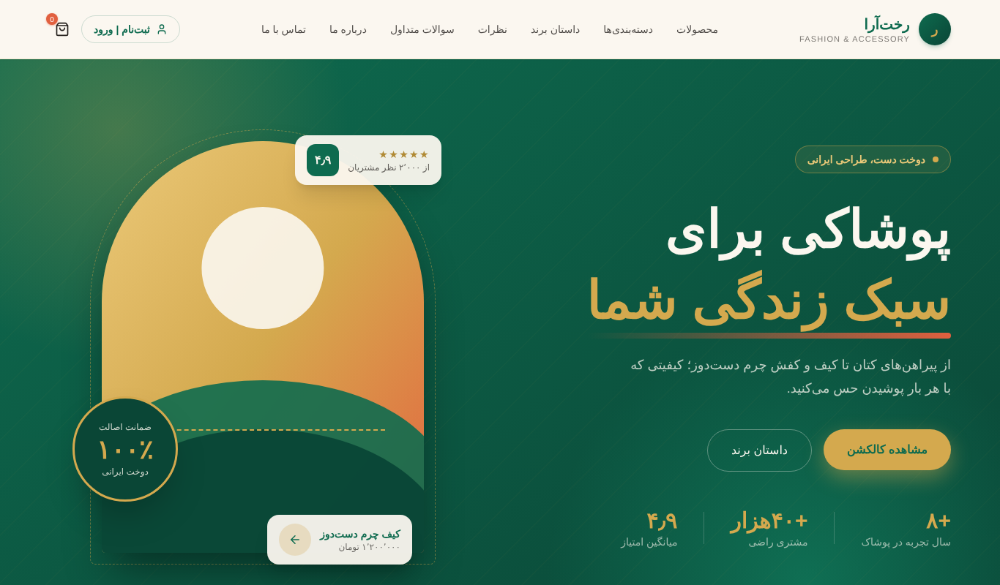
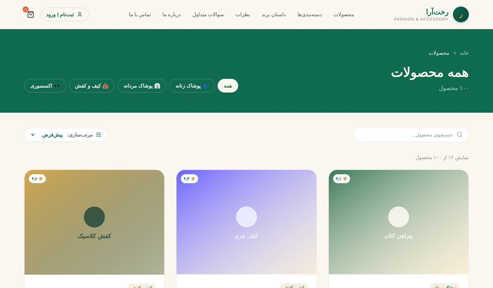
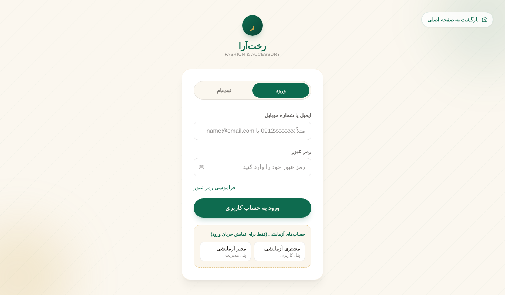
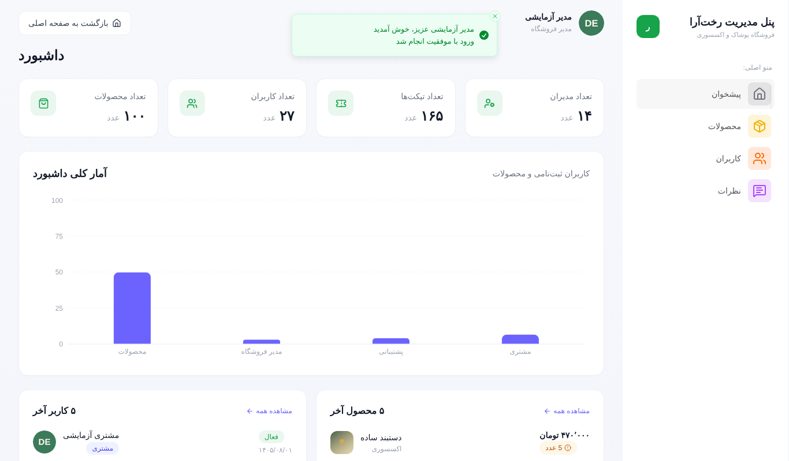

# رخت‌آرا

فروشگاه آنلاین پوشاک (فارسی، RTL) با ویترین کامل و پنل مدیریت.

- **نسخه آنلاین:** `https://USERNAME.github.io/REPO/` (پس از فعال‌سازی GitHub Pages؛ نام کاربری و مخزن را جایگزین کنید)
- **فناوری:** React 19، Vite، Tailwind 4، React Router 7، TanStack Query، React Hook Form + Zod، Zustand، Framer Motion، Swiper، Recharts

| صفحه اصلی | محصولات |
| --- | --- |
|  |  |

| ورود | پنل مدیریت |
| --- | --- |
|  |  |

## راه‌اندازی محلی

```
npm install
npm run dev
```

این نسخه سرور جداگانه ندارد؛ API در خود مرورگر شبیه‌سازی می‌شود (بخش «داده‌ها» در ادامه).

## انتشار روی GitHub Pages

1. پروژه را در یک مخزن GitHub بسازید و روی شاخه `main` push کنید.
2. در مخزن: **Settings → Pages → Source** را روی **GitHub Actions** بگذارید.
3. با هر push، فایل `.github/workflows/deploy.yml` پروژه را lint و build می‌کند و روی `https://USERNAME.github.io/REPO/` منتشر می‌کند. حساب‌های آزمایشی در نسخه آنلاین نمایش داده می‌شوند.

مسیر پایه از نام مخزن ساخته می‌شود (`VITE_BASE_PATH`) و `404.html` برای باز شدن مستقیم مسیرهای داخلی (مثل `/products`) ساخته می‌شود.

## داده‌ها (بک‌اند شبیه‌سازی‌شده)

- داده اولیه (محصولات، کاربران، نظرات و ...) در `src/mock/db.json` است.
- یک آداپتر axios (`src/mock/adapter.js`) درخواست‌های `services/` را مثل json-server پاسخ می‌دهد: فیلتر، `:contains`، `:gt/:lte`، مرتب‌سازی چندفیلدی و صفحه‌بندی `_page`/`_per_page`.
- تغییرات (سفارش‌ها، ثبت‌نام، ویرایش‌های پنل مدیریت) در `localStorage` همان مرورگر ذخیره می‌شود؛ هر بازدیدکننده نسخه خودش را دارد و تغییرات او برای دیگران دیده نمی‌شود. برای بازگشت به داده اولیه، داده‌های سایت را در مرورگر پاک کنید.
- برای اتصال به بک‌اند واقعی فقط `adapter` در `src/services/api.js` را حذف کنید و `baseURL` بگذارید؛ سایر کدها تغییری نمی‌کند.

## قابلیت‌ها

**ویترین**
- فهرست محصولات با جست‌وجو، فیلتر دسته، مرتب‌سازی و صفحه‌بندی سمت API
- صفحه جزئیات با گالری، انتخاب سایز، محصولات مرتبط (اسلایدر خودکار) و نظرات (بارگذاری بیشتر)
- سبد خرید جدا برای هر کاربر، با کنترل موجودی
- فرم‌های تماس، خبرنامه، ثبت نظر، ویرایش پروفایل و تغییر رمز

**پنل مدیریت**
- داشبورد آمار و نمودار، مدیریت محصولات، کاربران، نظرات، پیام‌های تماس و تصاویر ویترین
- تأیید پیش از حذف، ویرایش و خروج

**احراز هویت و دسترسی**
- ورود و ثبت‌نام، `ProtectedRoute` برای `/account` و `/admin`، نقش‌های `user` و `admin`
- ثبت‌نام همیشه با نقش «مشتری»؛ نقش در پنل مدیریت تغییر می‌کند

**تجربه کاربری**
- وضعیت‌های Loading (اسکلتون اختصاصی هر صفحه)، Empty / Not Found اختصاصی، Error با دکمه تلاش مجدد و Success (toast)
- بنر قطع اینترنت و به‌روزرسانی خودکار داده‌ها پس از اتصال
- جلوگیری از ارسال تکراری فرم‌ها (غیرفعال شدن دکمه در حال ارسال)
- دسترس‌پذیری: لینک «پرش به محتوا»، focus-visible، `aria-*`، احترام به `prefers-reduced-motion`
- ریسپانسیو برای موبایل، تبلت و دسکتاپ

## معماری

ساختار فیچر‌محور؛ هر قابلیت کامپوننت‌های خودش را دارد و بخش‌های مشترک جدا هستند.

```
src/
  mock/            بک‌اند شبیه‌سازی‌شده (db.json، آداپتر، موتور کوئری)
  features/        auth, account, cart, contact, about, product, storefront, cms
  components/      shared, forms, layouts, skeletons, errors   (مشترک بین فیچرها)
  pages/           صفحات مسیرها (lazy)
  services/        لایه API (axios)
  lib/             routes, query (کلیدها و کش), hooks, roles, errorToast
  context/         AuthContext
  stores/          Zustand: cart, loading, cmsProductsFilter
  utils/           اسکیمای Zod
```

**داده و کش.** همه درخواست‌ها از `services` و TanStack Query می‌گذرند. کلیدها در `lib/query/keys.js` و ابطال کش در `invalidate.js`. فیلتر و صفحه‌بندی با `_page`/`_per_page`/`field:contains` به لایه API داده می‌شود و فقط داده همان صفحه دریافت می‌شود. صفحه جزئیات ابتدا از کش لیست پر می‌شود. خطای GET در axios به toast مناسب تبدیل می‌شود و queryها فقط برای خطاهای غیر ۴xx یک بار تکرار می‌شوند.

**State.** وضعیت سرور در TanStack Query، وضعیت ورود در Context، وضعیت محلی UI در Zustand (سبد، فیلتر پنل) و URL (صفحه و جست‌وجو).

**عملکرد.** صفحات با `React.lazy` و پیش‌بارگذاری در زمان بیکاری، تصاویر با `loading="lazy"`، تقسیم vendor با `manualChunks` (charts، motion، swiper، router، forms، data)، React Compiler برای کاهش رندرهای غیرضروری و `memo` در کارت‌ها. حجم هر chunk پس از `npm run build` در خروجی چاپ می‌شود؛ chunk نمودارها فقط با پنل مدیریت بارگذاری می‌شود.

## امنیت و محدودیت‌ها

این پروژه یک نمونه‌کار با بک‌اند شبیه‌سازی‌شده در مرورگر است، نه سیستم امن تولیدی:

- نقش و نشست در `sessionStorage` قابل دست‌کاری است. `ProtectedRoute` فقط جریان ورود و مجوزها را نشان می‌دهد؛ مخفی کردن دکمه یا محافظت از Route در فرانت‌اند مجوز دسترسی امن ایجاد نمی‌کند. هنگام بارگذاری، کاربر دوباره از سرور بررسی می‌شود و نقش دست‌کاری‌شده اصلاح می‌گردد، اما هر کاربری می‌تواند داده خودش را در مرورگر دست‌کاری کند.
- رمزها با SHA-256 (و salt ثابت) در مرورگر هش می‌شوند؛ این فقط از نمایش متن ساده جلوگیری می‌کند و جایگزین هش سمت سرور (bcrypt/argon2) نیست. حساب‌های آزمایشی عمداً عمومی هستند.
- در پروژه واقعی باید احراز هویت (JWT/کوکی HttpOnly)، هش رمز، بررسی نقش و محدودیت نرخ درخواست در بک‌اند انجام شود.
- ورودی همه فرم‌ها با Zod اعتبارسنجی می‌شوند و React خروجی را escape می‌کند.
